# Camera control on real drone footage and TartanAir

**Benchmarks**
- **MotionScape (MS):** real drone footage, 25 clips.
- **Sekai (SK):** real drone footage, 25 clips.
- **TartanAir (TA):** 25 held-out windows.

**Protocol**
- ViPE successfully recovered camera trajectories for every method on all 25 clips per dataset. Each reported mean and standard error uses all 25 clips.
- Seed 0 for every method. Values are mean ± 1×SE, the same basis as Table 1 of the paper.
- **Metric:** ViPE recovers the camera path of each generated video, which is compared with the target camera path.
  - Rotation error in degrees, lower is better.
  - Length-normalised translation error, lower is better.
- **Resolution:** Captain Safari generates at its native 1280×704 on MS/SK and is scored on the centre square. Every other method generates at 640×640.
- **Path magnitude:** each baseline is fed the target path at its own native translation magnitude.

| Method | MS Rot. ↓ | MS Trans. ↓ | SK Rot. ↓ | SK Trans. ↓ | TA Rot. ↓ | TA Trans. ↓ |
|---|---|---|---|---|---|---|
| Wan2.2-Fun-5B-Control-Camera (VideoX-Fun) | 19.43±3.53 | 0.179±0.043 | 3.14±0.60 | **0.110±0.016** | 15.47±1.08 | 0.197±0.018 |
| Wan2.2-Fun-5B-Control-Camera (Captain Safari pipeline) | 19.58±3.55 | 0.148±0.023 | 2.45±0.53 | 0.118±0.017 | 15.94±0.99 | 0.231±0.017 |
| Captain Safari (w/o Mem.) | 12.87±2.58 | 0.167±0.029 | 10.15±1.66 | 0.207±0.031 | 31.46±2.68 | 0.395±0.038 |
| Captain Safari (First-frame Mem.) | 10.20±1.28 | 0.107±0.015 | 8.40±1.70 | 0.153±0.028 | 35.21±4.24 | 0.376±0.041 |
| Captain Safari (Full Mem.) | 10.26±1.50 | 0.111±0.020 | 6.59±1.28 | 0.156±0.023 | 35.34±4.55 | 0.343±0.032 |
| **WorldSlider (Ours, 2B)** | **5.10±1.80** | **0.101±0.030** | **1.61±0.60** | 0.118±0.041 | **8.49±3.34** | **0.105±0.019** |

## Examples

Each panel shows:
- **Top row:** trajectory errors, 3D camera paths and a top view. Black is the target camera path; coloured lines are the camera paths recovered from each generated video.
- **Video tiles:** WorldSlider (blue border) and the five baselines.

Click a preview to open the MP4.

### MotionScape (real drone footage)

| | |
|---|---|
| [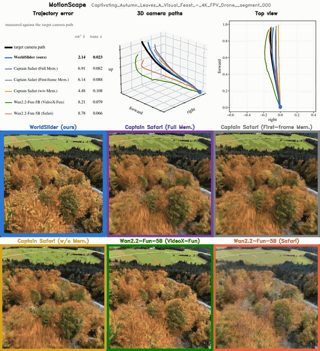](camera_control_real_drone/ms_Captivating_Autumn_Leaves_A_Visual_Feast_-_4K_FPV_Drone__segment_000.mp4) | [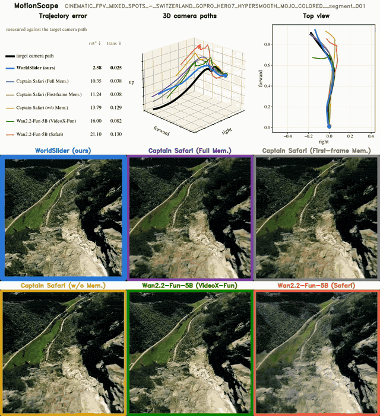](camera_control_real_drone/ms_CINEMATIC_FPV_MIXED_SPOTS_-_SWITZERLAND_GOPRO_HERO7_HYPERSMOOTH_MOJO_COLORED__segment_001.mp4) |
| [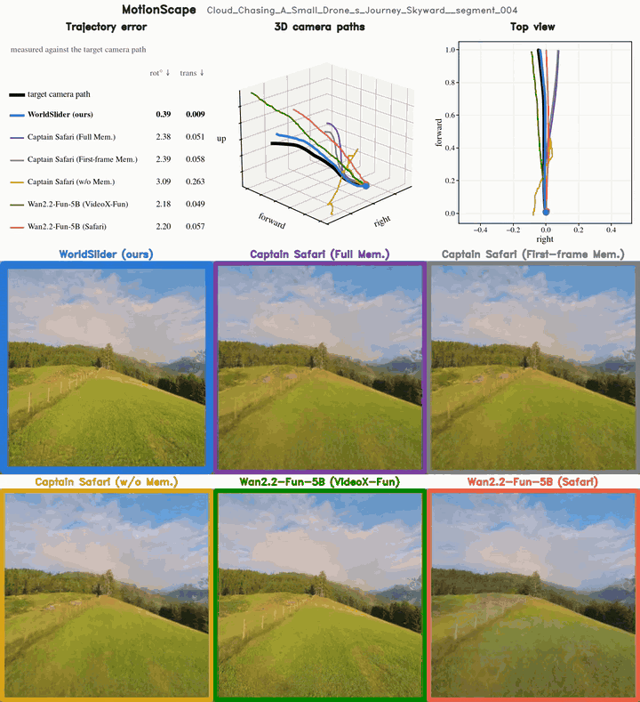](camera_control_real_drone/ms_Cloud_Chasing_A_Small_Drone_s_Journey_Skyward__segment_004.mp4) | [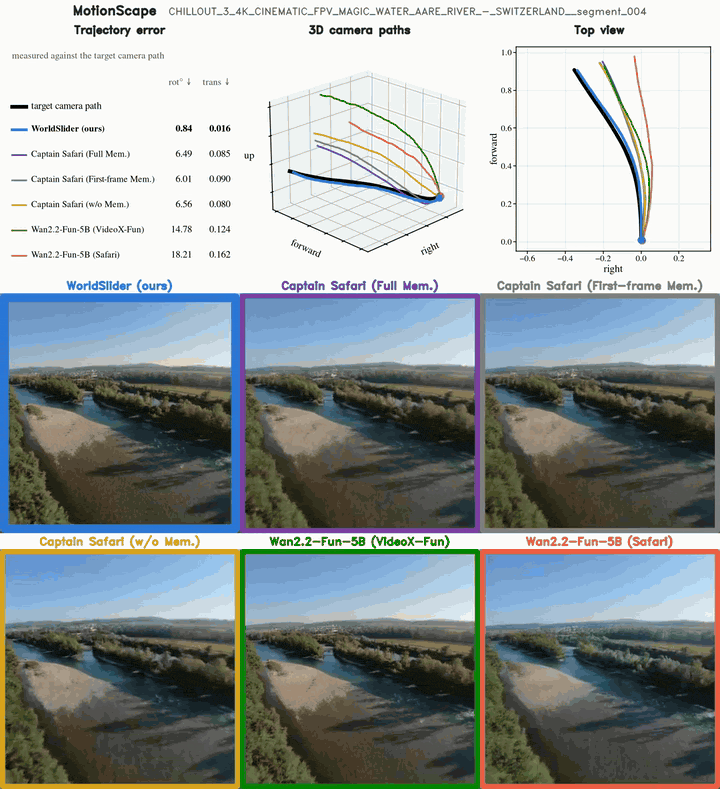](camera_control_real_drone/ms_CHILLOUT_3_4K_CINEMATIC_FPV_MAGIC_WATER_AARE_RIVER_-_SWITZERLAND__segment_004.mp4) |
| [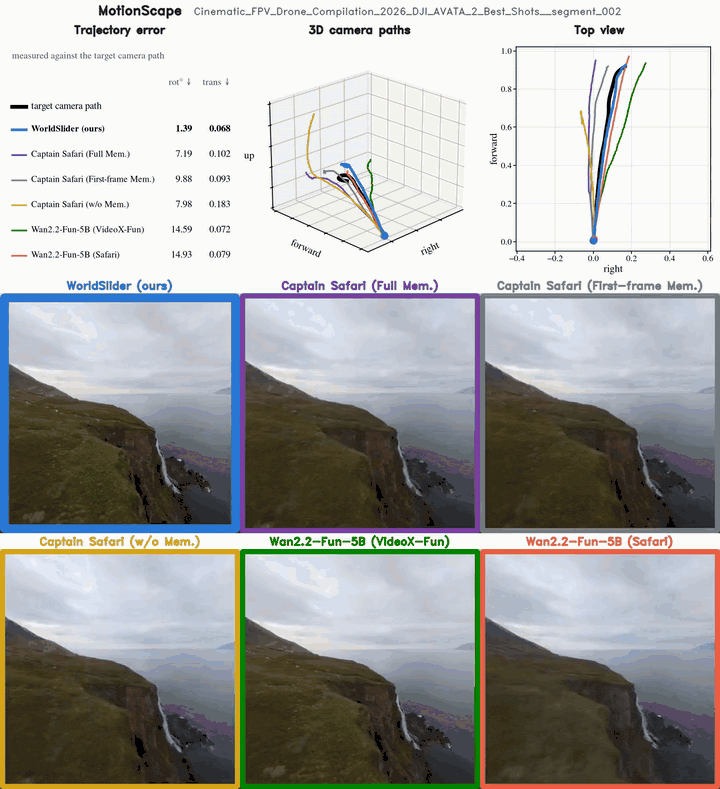](camera_control_real_drone/ms_Cinematic_FPV_Drone_Compilation_2026_DJI_AVATA_2_Best_Shots__segment_002.mp4) | [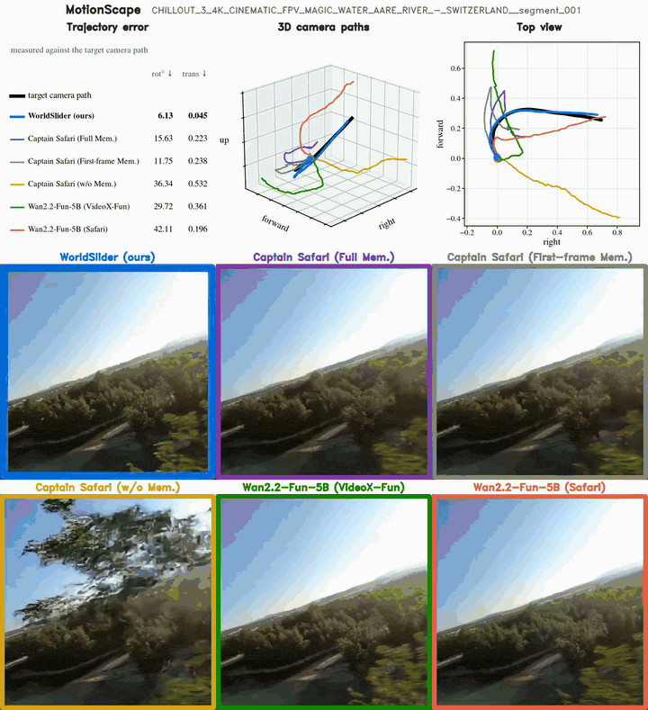](camera_control_real_drone/ms_CHILLOUT_3_4K_CINEMATIC_FPV_MAGIC_WATER_AARE_RIVER_-_SWITZERLAND__segment_001.mp4) |

### Sekai (real drone footage)

| | |
|---|---|
| [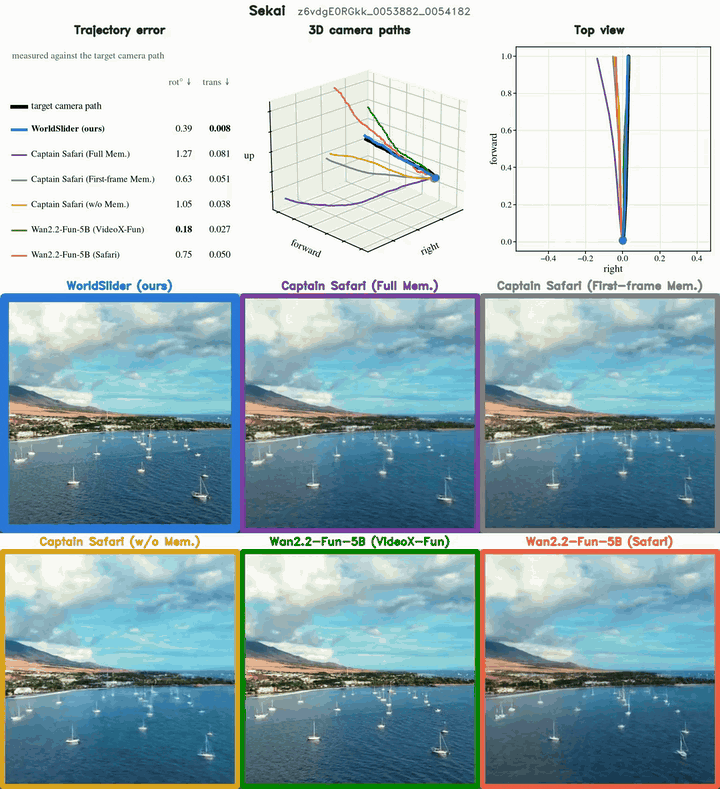](camera_control_real_drone/sk_z6vdgE0RGkk_0053882_0054182.mp4) | [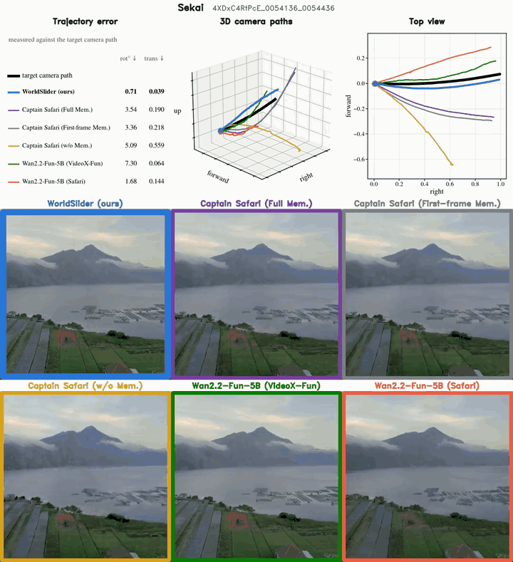](camera_control_real_drone/sk_4XDxC4RtPcE_0054136_0054436.mp4) |
| [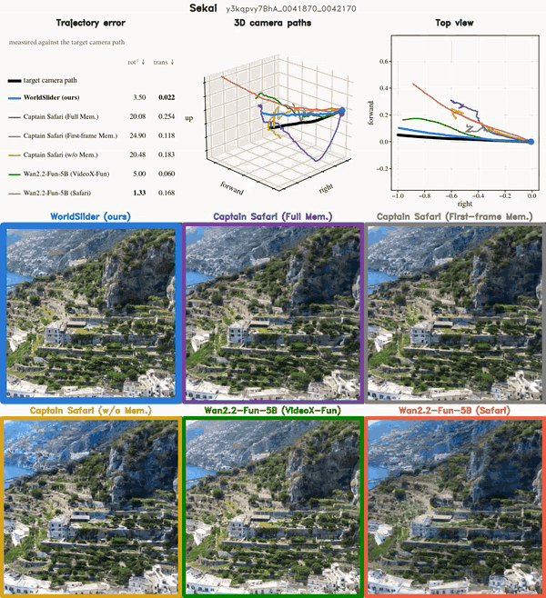](camera_control_real_drone/sk_y3kqpvy7BhA_0041870_0042170.mp4) | [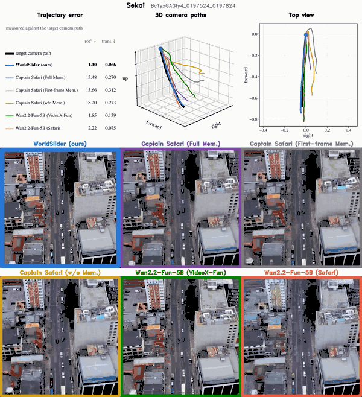](camera_control_real_drone/sk_BcTyxGAGty4_0197524_0197824.mp4) |

### TartanAir

| | |
|---|---|
| [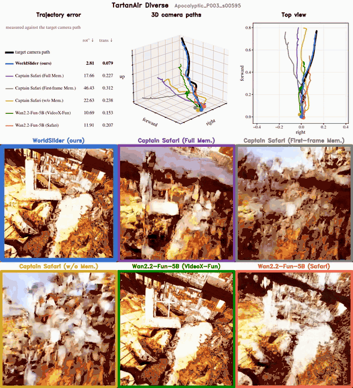](camera_control_real_drone/ta_Apocalyptic_P003_s00595.mp4) | [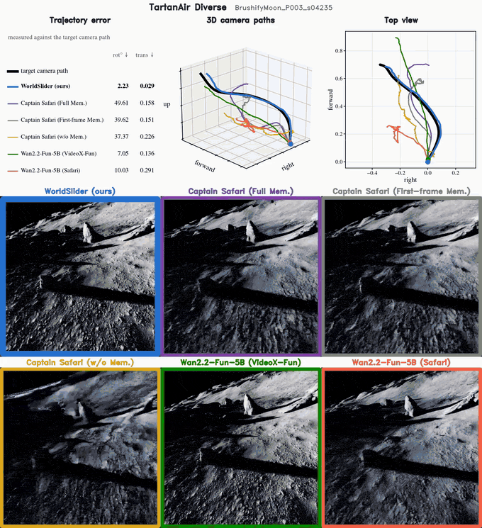](camera_control_real_drone/ta_BrushifyMoon_P003_s04235.mp4) |
| [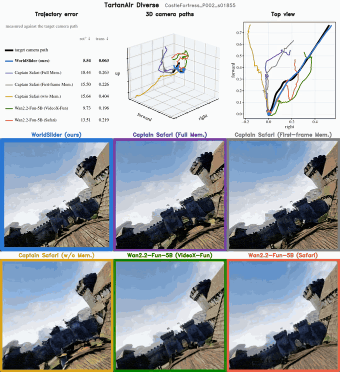](camera_control_real_drone/ta_CastleFortress_P002_s01855.mp4) | [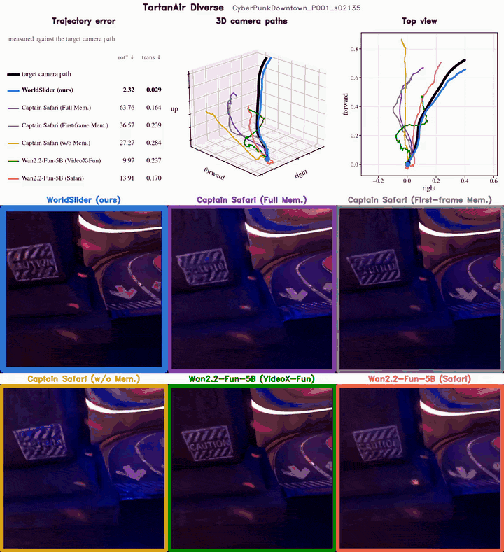](camera_control_real_drone/ta_CyberPunkDowntown_P001_s02135.mp4) |
