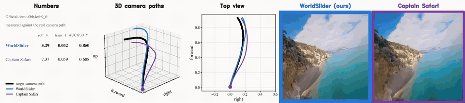
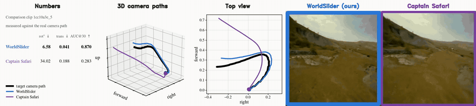
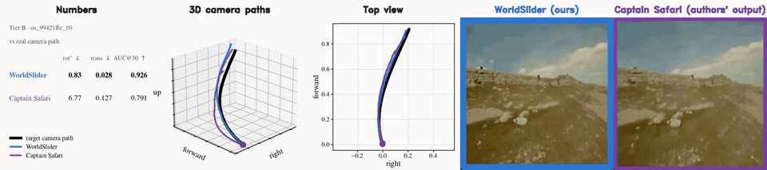
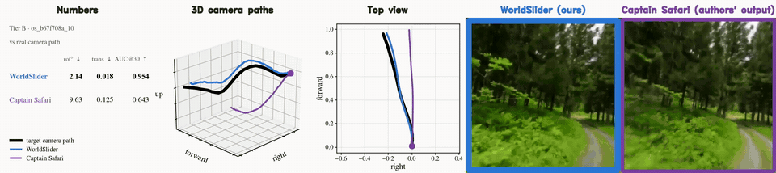
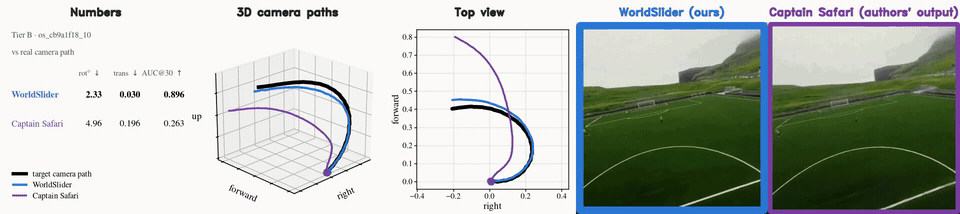

# Trajectory fidelity on five published Captain Safari examples

WorldSlider has lower rotation and translation error on all five examples. The reported means are **3.44° vs. 12.55°** for rotation and **0.032 vs. 0.139** for translation, in WorldSlider / Captain Safari order. The comparison covers the official demo and four supplementary examples with accompanying source footage.

## Per-clip results

Each cell lists **WorldSlider / Captain Safari**. Captain Safari reports AUC@30 for trajectory following. The AUC@30 column below gives our measurements on these five clips. [Captain Safari, Table 1](https://arxiv.org/html/2511.22815v1)

| Clip | Rotation error (°) ↓ | Path-normalized translation error ↓ | AUC@30 ↑ |
|---|---:|---:|---:|
| Official demo `0bb4eeb9_0` | **5.29** / 7.37 | **0.042** / 0.059 | **0.850** / 0.688 |
| `1cc10a3e_5` | **6.58** / 34.02 | **0.041** / 0.188 | **0.870** / 0.283 |
| `99421ffe_10` | **0.83** / 6.77 | **0.028** / 0.127 | **0.926** / 0.791 |
| `b67f708a_10` | **2.14** / 9.63 | **0.018** / 0.125 | **0.954** / 0.643 |
| `cb9a1f18_10` | **2.33** / 4.96 | **0.030** / 0.196 | **0.896** / 0.263 |
| **Mean (5 clips)** | **3.44** / 12.55 | **0.032** / 0.139 | **0.899** / 0.534 |

## Evaluation setup

- **Released demo.** We use the camera poses released by the Captain Safari authors as the prescribed trajectory.
- **Four supplementary examples.** We reconstruct camera trajectories from the real footage and use them as shared evaluation references. These results measure agreement with the reconstructed paths.
- **Generation and scoring.** WorldSlider takes the corresponding source first frame in a center-square crop and generates one clip with FlightGrid. We evaluate Captain Safari's published videos as provided by its authors. ViPE recovers a camera path from each output, and we apply the rotation and scale-aligned, path-normalized translation error protocol in Table 1 of our paper. Captain Safari's scores use its full 16:9 output. The previews show a center crop.

## Visual quality and trajectory fidelity

Captain Safari shows stronger visual quality in our side-by-side comparison of the five clips. Its pose-aligned 3D memory is designed to support long-horizon scene consistency. On the released demo, WorldSlider follows the published camera poses more closely, with 5.29° rotation error and 0.042 translation error compared with 7.37° and 0.059. [Captain Safari project](https://johnson111788.github.io/open-safari/) · [Supplementary comparisons](https://johnson111788.github.io/captain-safari-supp/#comparisons)

The recovered path overlay for `1cc10a3e_5` shows a visible deviation from the reconstructed reference in Captain Safari's published clip. This example has the largest rotation gap in the set, at 6.58° for WorldSlider and 34.02° for Captain Safari. The summary includes all five examples. Tracking the reference flight matters when generated observations are paired with the original waypoint and action annotations.

## Synchronized video comparisons

Each row shows the scores, recovered camera paths in 3D and top view, and the two generated videos. Black denotes the reference path, blue WorldSlider, and purple Captain Safari. Previews play at half speed. Click a preview for the MP4.

### Official demo `0bb4eeb9_0`

### `1cc10a3e_5`

### `99421ffe_10`

### `b67f708a_10`

### `cb9a1f18_10`

All five clips in one synchronized grid: [all_5_clips.mp4](captain_safari_official/all_5_clips.mp4)
