# Comparison with Lyra 2.0 and Voyager

**Methods**
- **Lyra 2.0:** per-frame 3D cache, built on Wan2.1-14B.
- **Voyager:** frame-0 point cloud, about 13B, released code.
- **WorldSlider:** ours, 2B.

**Protocol**
- We use the first 10 clips from each evaluation list (MotionScape, Sekai, and TartanAir), seed 0, and the baselines' official default inference settings.
- On one H200, generation takes about 10 seconds per clip for WorldSlider, 14 minutes for Lyra 2.0, and 9 minutes for Voyager.
- We report mean rotation (°) and translation errors by comparing ViPE-recovered trajectories with the target trajectories.

| Method | MS Rot. ↓ | MS Trans. ↓ | SK Rot. ↓ | SK Trans. ↓ | TA Rot. ↓ | TA Trans. ↓ | Visual collapses |
|---|---|---|---|---|---|---|---|
| Lyra 2.0 (14B) | **3.72** | 0.117 | **0.41** | **0.042** | 18.49 | 0.166 | 1 / 30 |
| Voyager (13B) | 14.30 | 0.173 | 0.94 | 0.043 | 28.22 | 0.358 | 6 / 30 |
| **WorldSlider (Ours, 2B)** | 5.15 | **0.101** | 1.30 | 0.092 | **4.96** | **0.081** | – |

All clips, including visually collapsed outputs, contribute to the reported means.

## Examples

Each example shows trajectory errors, WorldSlider (blue border), Lyra 2.0 and Voyager. Click a preview to open the MP4.

### MotionScape (real drone footage)

[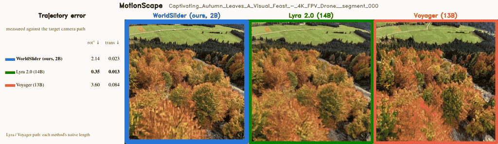](lyra_voyager/ms_Captivating_Autumn_Leaves_A_Visual_Feast_-_4K_FPV_Drone__segment_000.mp4)

[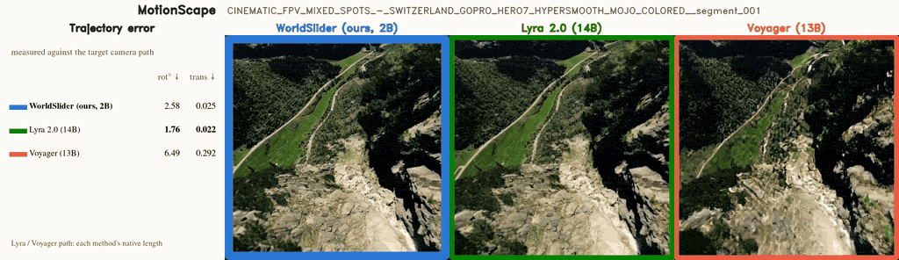](lyra_voyager/ms_CINEMATIC_FPV_MIXED_SPOTS_-_SWITZERLAND_GOPRO_HERO7_HYPERSMOOTH_MOJO_COLORED__segment_001.mp4)

[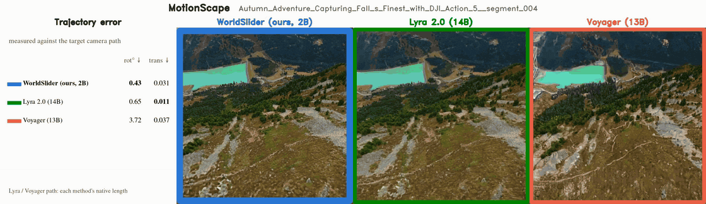](lyra_voyager/ms_Autumn_Adventure_Capturing_Fall_s_Finest_with_DJI_Action_5__segment_004.mp4)

[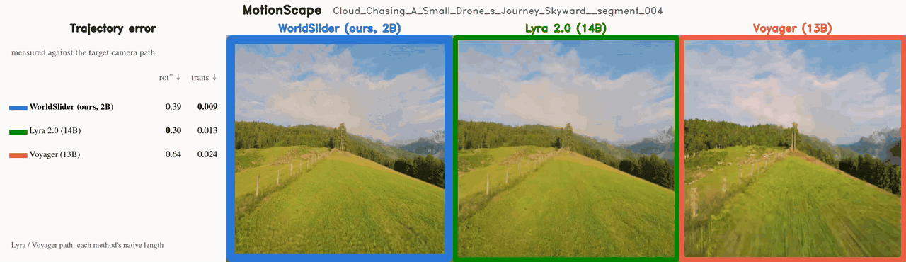](lyra_voyager/ms_Cloud_Chasing_A_Small_Drone_s_Journey_Skyward__segment_004.mp4)

[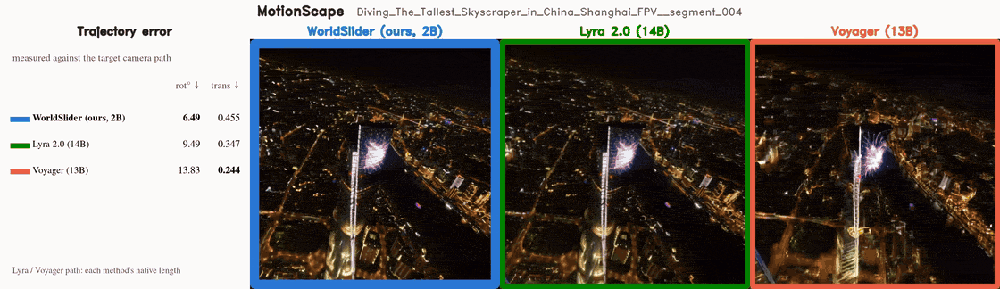](lyra_voyager/ms_Diving_The_Tallest_Skyscraper_in_China_Shanghai_FPV__segment_004.mp4)

[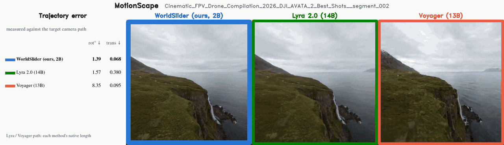](lyra_voyager/ms_Cinematic_FPV_Drone_Compilation_2026_DJI_AVATA_2_Best_Shots__segment_002.mp4)

### Sekai (real drone footage)

[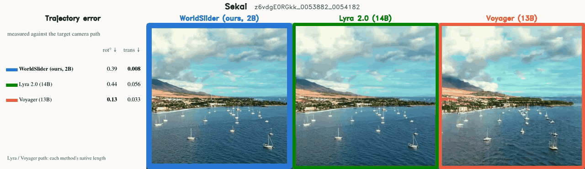](lyra_voyager/sk_z6vdgE0RGkk_0053882_0054182.mp4)

[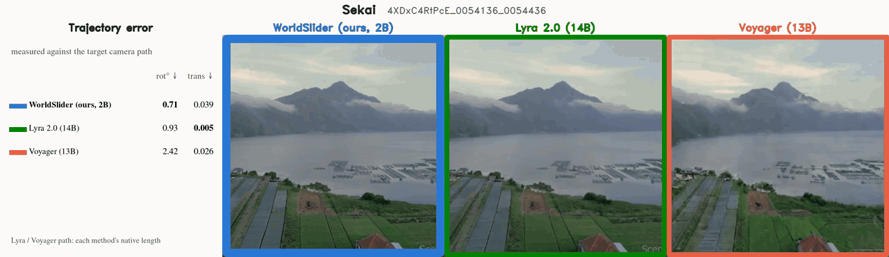](lyra_voyager/sk_4XDxC4RtPcE_0054136_0054436.mp4)

[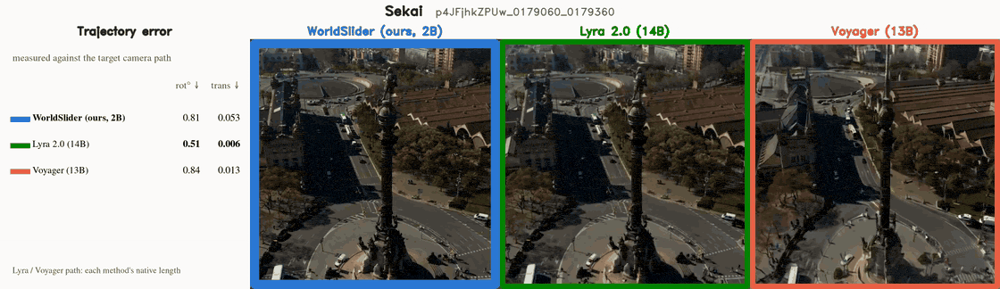](lyra_voyager/sk_p4JFjhkZPUw_0179060_0179360.mp4)

[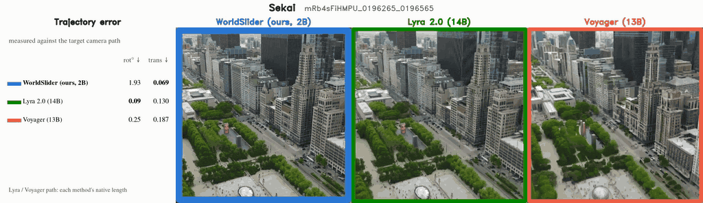](lyra_voyager/sk_mRb4sFiHMPU_0196265_0196565.mp4)

[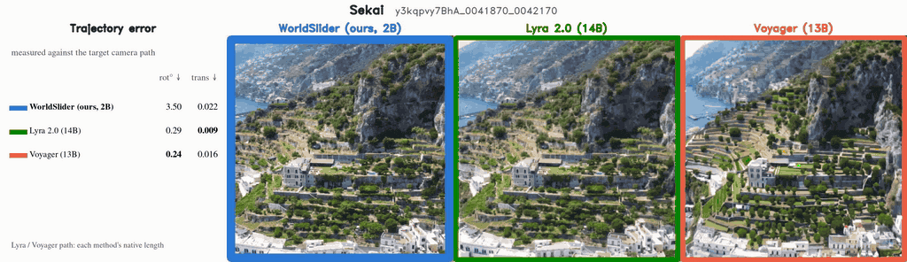](lyra_voyager/sk_y3kqpvy7BhA_0041870_0042170.mp4)

[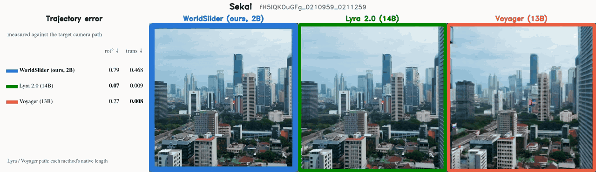](lyra_voyager/sk_fH5IQKOuGFg_0210959_0211259.mp4)

### TartanAir

[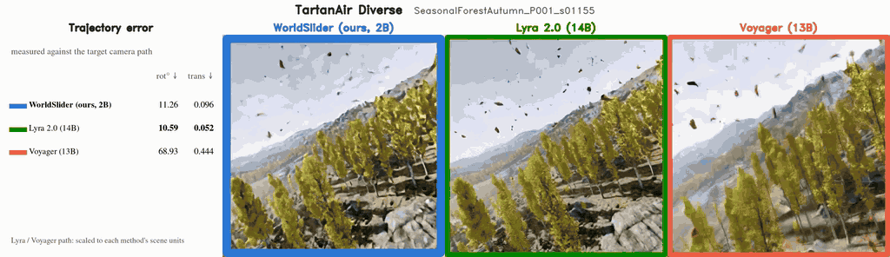](lyra_voyager/ta_SeasonalForestAutumn_P001_s01155.mp4)

[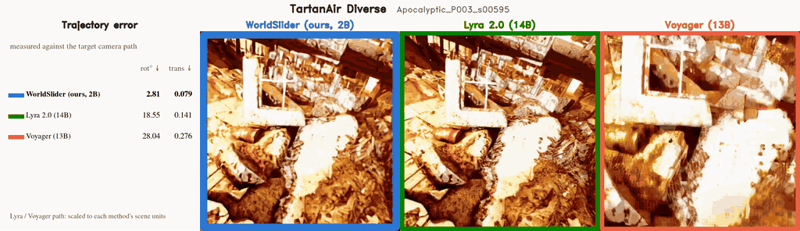](lyra_voyager/ta_Apocalyptic_P003_s00595.mp4)

[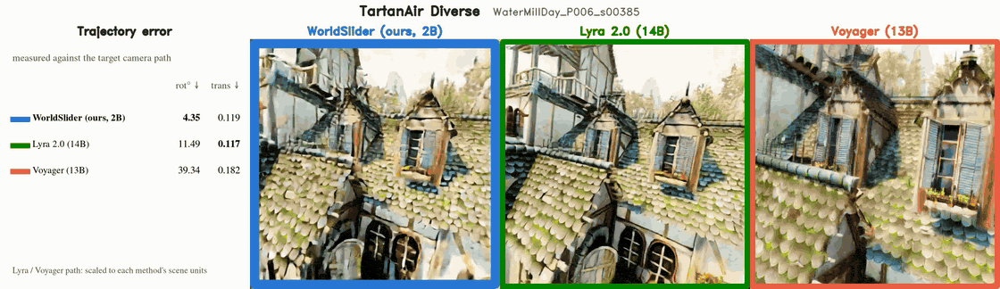](lyra_voyager/ta_WaterMillDay_P006_s00385.mp4)

[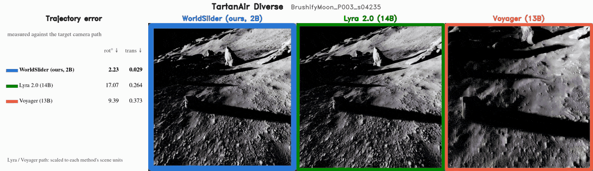](lyra_voyager/ta_BrushifyMoon_P003_s04235.mp4)

[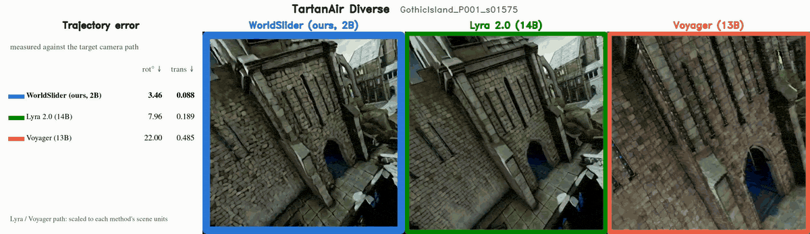](lyra_voyager/ta_GothicIsland_P001_s01575.mp4)

[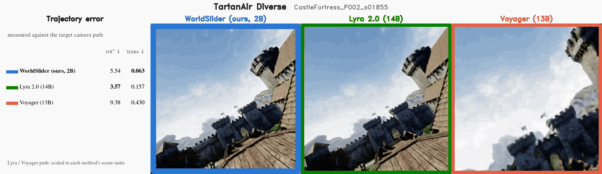](lyra_voyager/ta_CastleFortress_P002_s01855.mp4)
